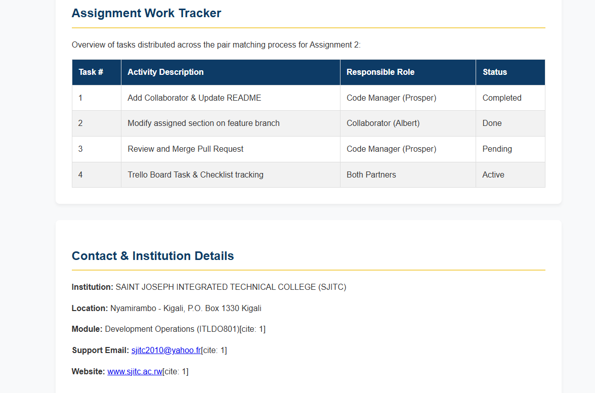

# DevOps Collaboration Portfolio

This repository contains my portfolio for the Development Operations module
(ITLDO801) at Saint Joseph Integrated Technical College (SJITC). I use it to
show the portfolio page and document the collaboration workflow for this
assignment.

## Portfolio collaborator

I have identified **Simbankabo Albert** as my portfolio collaborator.

- **GitHub username:** `simbalbert`
- **GitHub profile:** [github.com/simbalbert](https://github.com/simbalbert)
- **Portfolio link shared in the original README:** [Albert's portfolio](https://simbalbert.github.io/albert.github.com/)
- **Role:** Collaborator and developer

My role in the portfolio is **Code Manager / IT Engineer**. Adding these details
to this README records the intended collaboration; I still need to verify on
GitHub that the invitation was accepted before I submit the assignment.

## What is on my portfolio page

I use [`index.html`](./index.html) as the single-page portfolio. It has
responsive viewport metadata, and the page styles are currently written in the
file's `<style>` block. The design uses Arial, a dark-blue and gold palette,
white content panels, and a centered content area.

The page is organized into these sections:

1. **Header and navigation** — Shows the SJITC logo and institution name. The
   navigation links move to the About, Collaboration, Tasks Table, and Contact
   sections on the same page.
2. **Hero** — Introduces the Advanced Development Operations portfolio and
   module. It uses `photos/placeholder-team.jpg` as its background image.
3. **About the Project** — Explains that the portfolio demonstrates
   collaboration and DevOps workflow practices.
4. **Colleague Partnership Details** — Shows Prosper and Albert in team cards
   with their names, roles, and profile links. The images currently use the
   placeholder team photo; the profile links and images should be replaced or
   verified before final submission.
5. **Assignment Work Tracker** — A table lists assignment activities,
   responsible roles, and their displayed status. I should keep these statuses
   synchronized with the actual GitHub and Trello work.
6. **Contact & Institution Details** — Lists SJITC, its location, the module,
   and the institution's email and website.
7. **Footer** — Identifies the year, institution, and portfolio team.

The logo and team image are stored in the `photos/` folder. Images in the page
have alternative text. Before submitting, I should test the page in a browser,
check that every image and link works, and check its layout at a narrow screen
width.

## My collaboration workflow and assignment record

### Task 1 — Add a collaborator

I recorded Albert's name, GitHub username, profile link, and role above. To
complete the GitHub part, I will open this repository's **Settings →
Collaborators**, invite `simbalbert`, and confirm that the invitation is no
longer pending. I will keep a readable screenshot of the accepted collaborator
status and of this README as evidence.

### Task 2 — Build an agreed portfolio section

I will agree with Albert on one section before work begins so that we do not
duplicate each other's changes. The section currently visible in
[`index.html`](./index.html) should be treated as the existing portfolio
content; the exact new or modified section and its branch must be recorded here
once confirmed.

I will start from the latest `main`, create and work on a feature branch (not
directly on `main`), and keep the change consistent with the page's fonts,
colors, layout, and responsive behavior. I will test the finished page locally,
then make at least three small, meaningful commits and push the branch. I will
notify the code manager through the Trello card when it is ready for review.

- **Agreed section:** To be confirmed with Albert
- **Feature branch:** To be recorded after it is created
- **Branch/commit evidence:** Screenshot to be added to the assignment report

### Task 3 — Review and merge a pull request

As code manager, I will open a pull request from Albert's feature branch into
`main`. I will compare the changes, check that only the agreed section was
changed, leave a review comment or approval, and resolve any requested updates
or conflicts with Albert before merging. After the merge, I will check the
published portfolio and record the pull request link and final status.

- **Pull request:** To be recorded after it is created
- **Review and merge status:** To be confirmed; I will not report a merge as
  complete until GitHub shows it as merged
- **Trello card link:** To be added

### Task 4 — Track the work in Trello

I will create or use a Trello board with **To Do**, **In Progress**, **In
Review**, and **Done** lists. I will create the card with the exact title
**Update section in the portfolio**, describe the agreed section, repository,
and deadline, and assign Albert. Albert will add a checklist that records the
work, including the feature branch name. I will move the card as the work
progresses and move it to **Done** after the pull request is merged.

I will save a clear screenshot showing the card title, assigned member,
checklist and branch name, and current list for the report.

### Task 5 — Prepare the PDF report

I will prepare a PDF report with a cover page containing my full name,
registration number, module, assignment title, and date. I will include a short
section and captioned evidence for each of Tasks 1–4, then list:

- This repository: [Prosper20250285/devops-portfolio](https://github.com/Prosper20250285/devops-portfolio)
- My published portfolio: To be added after confirming its public URL
- Albert's repository, where I contributed as a collaborator: To be added

The report will include the collaborator, feature branch, pull request and merge
status, and Trello evidence. I will make sure the screenshots are readable and
show the relevant page title or URL and account details where possible.

### Task 6 — Reflect on collaboration

The report requires a 250–350 word reflection in my own words. I will write it
after completing the collaboration, using specific examples from the work. I
will explain how working with Albert changed my approach from Assignment 1,
what the pull request review improved, a challenge and how we handled it, how
branches/reviews/Trello support shared ownership and traceability, and what I
would do differently next time. I will not describe a review, conflict, or
improvement as something that happened unless it reflects our actual work.

## Before I submit

- [ ] Confirm Albert accepted the GitHub collaborator invitation.
- [ ] Record the agreed section and the actual feature branch name.
- [ ] Confirm the branch has at least three meaningful commits and is pushed.
- [ ] Test the page locally, including links, images, alt text, and small-screen
  layout.
- [ ] Record the pull request URL, review, merge status, and published-page
  check.
- [ ] Capture the requested GitHub and Trello screenshots.
- [ ] Add the verified published-portfolio URL and Albert's repository link.
- [ ] Create the PDF report and write my own 250–350 word reflection.

## Portifolio Images

